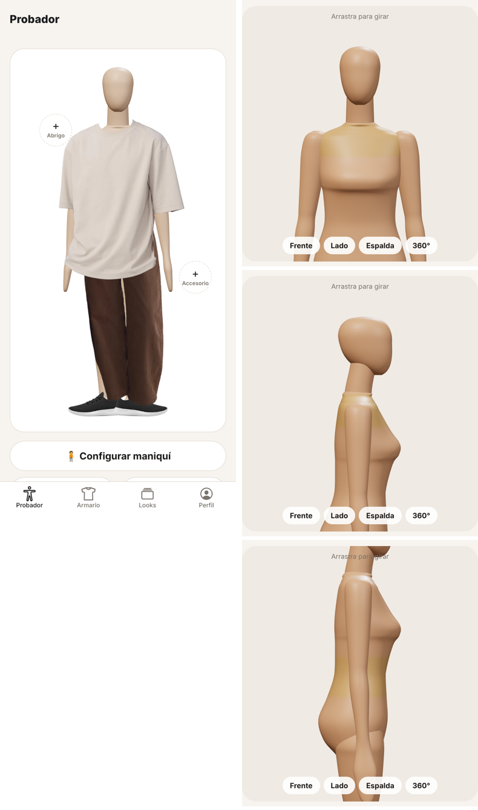
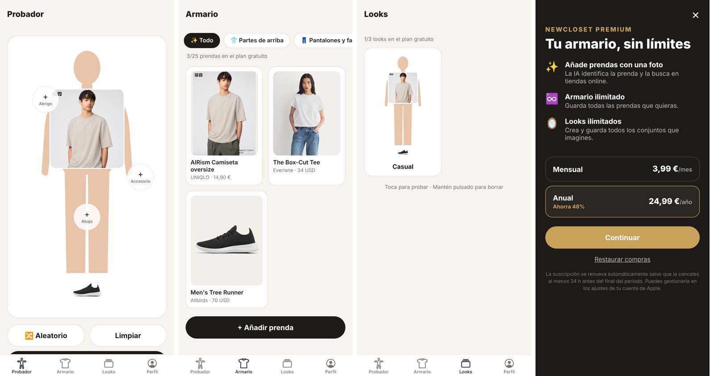

# NewCloset 👗

App para iOS (y Android) para organizar tu armario:

- **Importa prendas con un enlace** de cualquier tienda (Zara, Mango, Uniqlo, Shein…). La app descarga la página y saca foto, nombre, marca, precio y categoría.
- **Quitar el fondo automáticamente**: al guardar una prenda, el servidor la recorta (incluso si en la foto la lleva puesta un modelo: separa la camiseta, el pantalón o el vestido) y detecta su forma.
- **Maniquí 3D realista** generado a partir de tus medidas, con la ropa ajustada a tu cuerpo: hombros, cintura, largo de pierna… Pon **tu cara** (opcional) y elige tono de piel.
- **Configuración de maniquí**: vista 3D de 360° (arrastra para girar) con controles para ensanchar o reducir cada parte del cuerpo.
- **Looks**: guarda tus conjuntos y vuelve a probarlos con un toque.
- **Premium**: añade una prenda **con una foto** y la IA (Claude) la identifica y la busca en tiendas online. Además, prendas y looks ilimitados.





## Cómo funciona el maniquí

1. **Cuerpo paramétrico** (`src/lib/body/model.ts`): a partir de altura, hombros, pecho, cintura, cadera, muslo, gemelo, brazo, cuello y entrepierna se calculan las proporciones y se generan anillos de sección del cuerpo (con relieve de pecho y glúteos). Hay base mujer y base hombre.
2. **Vista 3D** (`src/components/MannequinGL.tsx`): three.js sobre `expo-gl` crea la malla, la ilumina como un maniquí de estudio y permite girarla 360°.
3. **Recorte de prendas** (`server/segment.ts`): dos modelos de segmentación (ONNX, se ejecutan en tu servidor sin coste por uso):
   - `u2net_cloth_seg` separa ropa de arriba / de abajo / de cuerpo entero aunque la lleve puesta una persona.
   - `isnet-general-use` recorta cualquier objeto (zapatos, bolsos, prendas sobre fondo liso).
   El servidor devuelve la imagen transparente y la **forma** de la prenda (silueta por filas y número de piezas).
4. **Ajuste al cuerpo** (`src/lib/body/fit.ts`): detecta los hombros de la camiseta en su silueta y los coloca sobre los hombros del maniquí; la cinturilla del pantalón en tu cintura y el bajo en tu tobillo; los zapatos en los pies (si la foto es de un solo zapato, lo duplica en espejo). Después ensancha o estrecha la prenda según tu cuerpo comparado con el cuerpo de referencia.

## Modelo de negocio

| | Gratis | Premium (3,99 €/mes · 24,99 €/año) |
|---|---|---|
| Prendas | 25 | Ilimitadas |
| Looks guardados | 3 | Ilimitados |
| Búsqueda por foto con IA | 1 de prueba | Sí |

Los límites están en `src/lib/store.tsx` (`FREE_LIMITS`) y los precios en `src/lib/purchases.ts`.

## Estructura

```
src/app/            Pantallas (Expo Router)
  (tabs)/index.tsx    Probador (maniquí)
  (tabs)/wardrobe.tsx Armario
  (tabs)/outfits.tsx  Looks guardados
  (tabs)/profile.tsx  Cara, tono de piel y plan
  add.tsx             Añadir prenda: enlace / foto IA / manual
  pick/[slot].tsx     Elegir prenda para una zona del maniquí
  garment/[id].tsx    Editar / eliminar prenda
  paywall.tsx         Pantalla Premium
src/lib/importer.ts Importador de enlaces (JSON-LD, OpenGraph)
src/lib/store.tsx   Estado + guardado local (AsyncStorage)
src/lib/purchases.ts Compras in-app (modo demo por ahora)
server/             Backend de IA (Node + Claude)
```

## Probarla en tu móvil

```bash
npm install
```

```bash
npx expo start
```

Escanea el QR con la app **Expo Go** en tu iPhone. (En la web la importación por enlace no funciona porque el navegador bloquea las descargas a otras webs; en el móvil sí.)

## Servidor (quitar fondos + IA por foto)

La clave de la API de Anthropic **nunca** va dentro de la app: vive en el servidor.

```bash
cd server && npm install
```

Descarga los modelos de recorte (~350 MB, una sola vez):

```bash
npm run models
```

```bash
ANTHROPIC_API_KEY=sk-ant-... npm start
```

Luego crea un `.env` en la raíz con `EXPO_PUBLIC_API_URL=http://<IP-de-tu-ordenador>:8787` (ver `.env.example`). Para producción, despliega `server/` en Railway, Render, Fly.io o similar y pon esa URL (https).

Quitar fondos no usa Claude ni tiene coste por uso, pero el servidor necesita ~1,5 GB de RAM para los modelos. Cada búsqueda por foto hace 2 llamadas a Claude (identificar la prenda + búsqueda web), así que tiene coste por uso: por eso es Premium.

## Publicar en la App Store

1. Cuenta de **Apple Developer** (99 $/año).
2. Cambia `ios.bundleIdentifier` en `app.json` por uno tuyo (p. ej. `com.tunombre.newcloset`).
3. **Compras reales**: crea las suscripciones en App Store Connect con los IDs de `src/lib/purchases.ts`, integra RevenueCat (`react-native-purchases`) en las funciones `purchase()` / `restorePurchases()` y pon `DEMO_PURCHASES = false`. Esto requiere un *development build* (no Expo Go).
4. Compila y sube con Expo Services:

```bash
npx eas-cli@latest build --platform ios
```

```bash
npx eas-cli@latest submit --platform ios
```

5. En App Store Connect: capturas, descripción, **política de privacidad** (obligatoria: la app usa cámara y fotos) y enlace a los términos de la suscripción.

## Próximos pasos recomendados

- Probador 3D completo: vestir la malla 3D (ahora la ropa se ve en la vista frontal; en la vista 360° se muestra el cuerpo).
- Recorte en el propio iPhone con Vision (iOS 17+) para no depender del servidor.
- **Compartir desde la tienda**: extensión "Compartir" de iOS para mandar un enlace a NewCloset sin copiar/pegar.
- Sincronización en la nube / cuentas de usuario.
- Enlaces de afiliado en "Ver en la tienda" como segunda fuente de ingresos.
